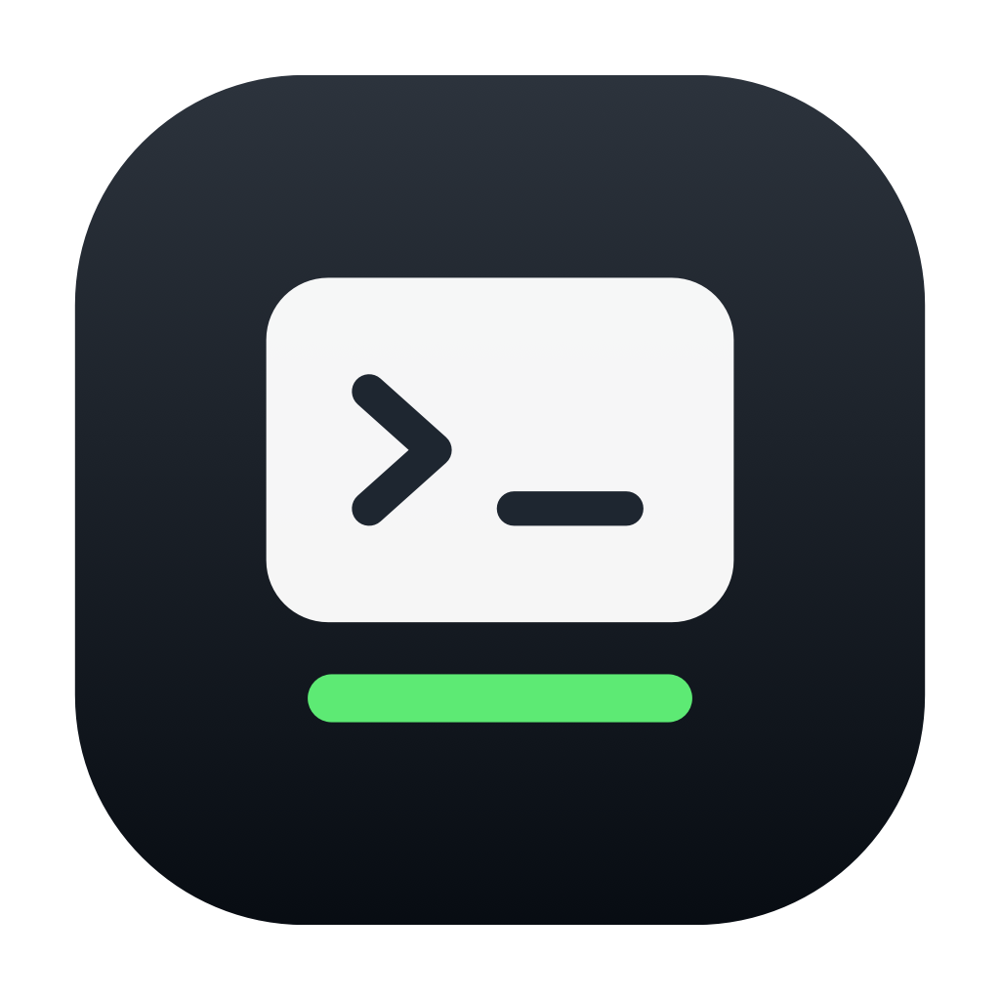
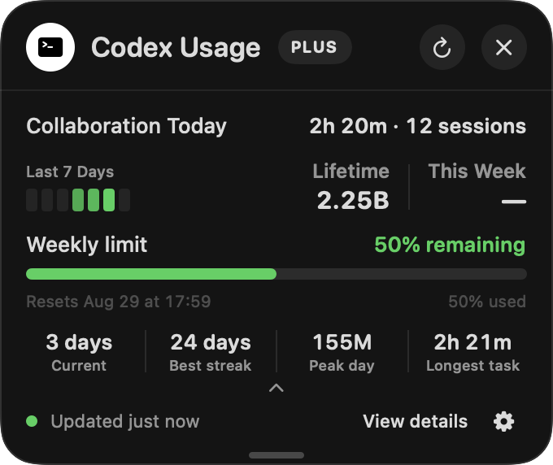
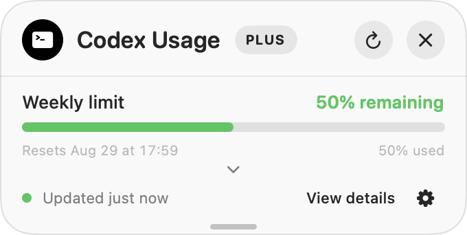
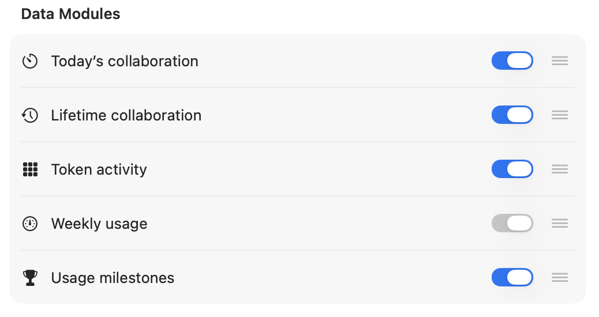
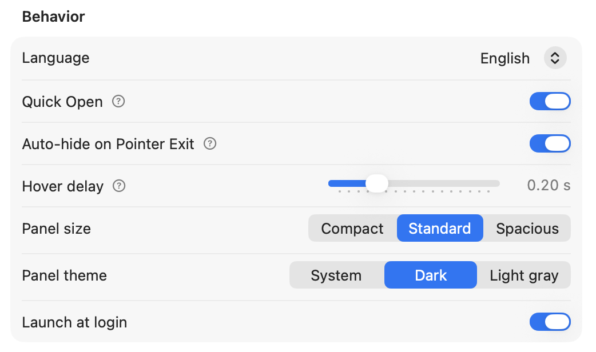
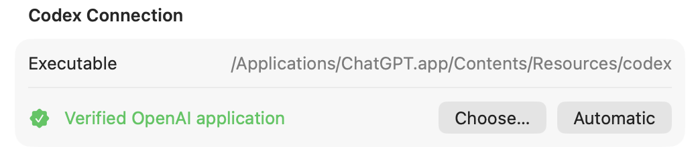

# QuotaNotch

  

  <strong>Codex usage, right by the notch.</strong> 
  A native macOS companion for weekly quota and optional activity summaries.

  <strong>English</strong> · <a href="README.zh-CN.md">简体中文</a> · <a href="README.zh-Hant.md">繁體中文</a>

  <a href="https://github.com/GuojianSun/QuotaNotch/releases/latest"><strong>Download the latest release</strong></a>
  ·
  <a href="#download-and-install">Installation</a>

QuotaNotch opens from the physical MacBook notch and keeps the current Codex weekly limit close to your workflow. A menu-bar entry provides the same access on Macs without a notch and when using an external display.

## 1.1.1 (15)

[Release details](https://github.com/GuojianSun/QuotaNotch/releases/tag/v1.1.1)

- Restores the Codex connection after recent ChatGPT updates moved its bundled executable.
- Supports server-reported Pro and ProLite plans, including current weekly usage and Token activity.
- Plus and Pro-family accounts can independently enable and reorder 5-hour and weekly quota modules, with at least one kept enabled. Only windows actually supplied by Codex are shown.
- Automatic quota display switching is enabled by default: it prioritizes 5-hour usage and switches to weekly usage at exactly 0% remaining, showing both reset times.

1.1.1 (15) is the latest stable release. Screenshots illustrate the core interface; available quota modules depend on the account plan and data supplied by Codex.

## Interface

### Expanded activity view

### Compact weekly limit

### Configurable modules

<strong>More settings</strong>

#### Behavior

#### Codex connection

Screenshots show point-in-time aggregate data from the real SwiftUI/AppKit interface. Actual values depend on each account and local history.

## Highlights

- Open by hovering at the notch or from the menu bar.
- See weekly usage, remaining percentage, reset time, refresh status, and the Codex plan label.
- Expand into optional Token activity, collaboration, and usage-milestone modules.
- Reorder modules and choose compact, standard, or spacious panel width.
- Follow the system appearance or use dark and light-gray themes.
- Move the panel away from the notch while keeping the header stable during expansion.
- Configure launch at login, hover delay, and pointer-exit behavior.
- Switch between English, Simplified Chinese, and Traditional Chinese.

## Data modules

| Module | Summary |
| --- | --- |
| **Weekly limit** | Used and remaining percentage, reset time, plan label, and eligible reset-credit alerts. Always visible. |
| **Token activity** | Seven-day heatmap plus lifetime and current-week aggregate Token totals when available. |
| **Collaboration Today** | Optional local summary of today's recoverable Codex task duration and qualifying sessions. |
| **Lifetime collaboration** | Optional duration and session totals reconstructed from compatible local Codex history. |
| **Usage milestones** | Current and best streak, peak Token day, and longest recorded task when available. |

Quota and Token aggregates are requested through the locally installed Codex process using the user's existing login. Optional collaboration summaries extract only timing and terminal-state metadata on this Mac; QuotaNotch does not extract or retain conversation text.

## Requirements

- macOS 14 Sonoma or later
- Apple silicon Mac (M1 or later)
- An existing Codex login
- A Codex executable supplied by an OpenAI-signed Codex or ChatGPT macOS application, or another executable explicitly selected by the user

A physical notch is optional; the menu-bar entry works on supported Macs and external displays.

## Download and install

1. Download the latest DMG from [GitHub Releases](https://github.com/GuojianSun/QuotaNotch/releases/latest).
2. Open the DMG and drag **QuotaNotch** to **Applications**.
3. Open QuotaNotch from Applications.

If macOS blocks the first launch, open **System Settings → Privacy & Security** and choose **Open Anyway** for QuotaNotch.

Each release includes a SHA-256 checksum. See the [Security Policy](SECURITY.md) for release-integrity details and vulnerability reporting.

## Privacy

QuotaNotch contains no analytics, advertising, or user-tracking SDK. It does not upload conversation content. Optional collaboration summaries are processed locally and can be cleared from Settings. Quota requests still use the user's existing Codex session to communicate with the service.

Read the complete [Privacy Policy](PRIVACY.md).

## Updates

Built-in updates use an HTTPS feed and Sparkle EdDSA signatures. Stable and beta selections are separate, and an update is offered only when its archive signature matches the public key embedded in QuotaNotch.

## Support

- Feature requests and bug reports: [GitHub Issues](https://github.com/GuojianSun/QuotaNotch/issues)
- Security reports: [private vulnerability reporting](https://github.com/GuojianSun/QuotaNotch/security/advisories/new)
- Release history: [Changelog](CHANGELOG.md)

Never post `auth.json`, access tokens, conversation content, or private paths in an Issue.

## License and attribution

This repository is the public product, documentation, support, and binary-distribution home for QuotaNotch. The implementation source remains private. Official binaries are licensed under the proprietary [QuotaNotch Binary License](BINARY-LICENSE.md); third-party components retain their own licenses.

Copyright © 2026 Guojian Sun. All rights reserved.

QuotaNotch is an independent project and is not affiliated with or endorsed by OpenAI. OpenAI, Codex, and ChatGPT are trademarks of OpenAI.
