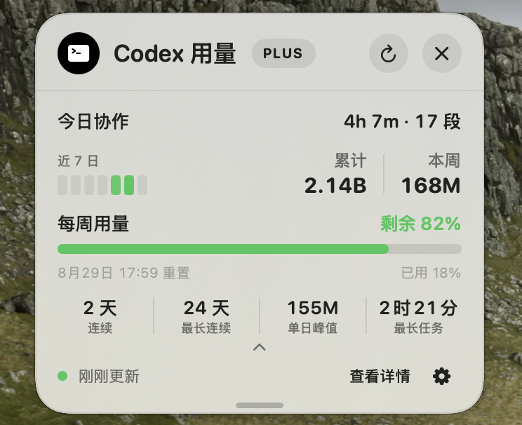
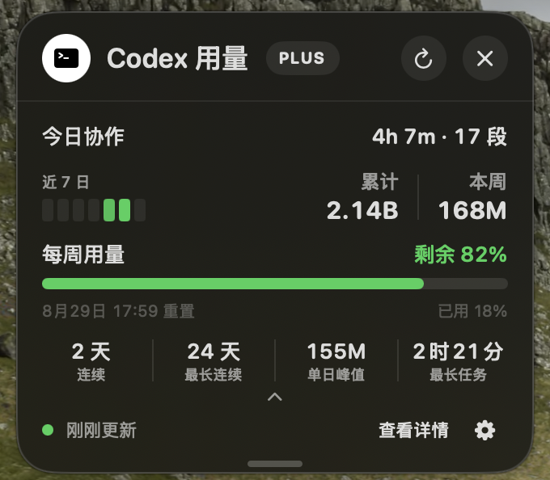
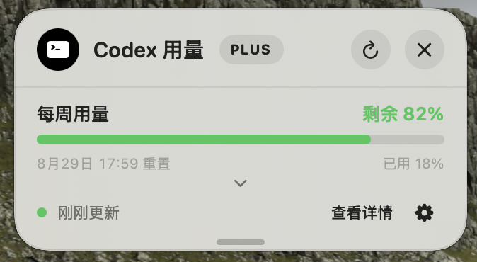
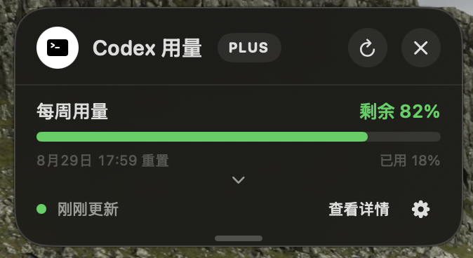

# QuotaNotch

  <strong>把 Codex 用量放在 MacBook 刘海旁。</strong>

  一款轻巧的原生 macOS 助手，无需离开当前工作即可查看额度与可选的本地活动统计。

  

  macOS 14 或更高版本 · Apple 芯片 
  <a href="./README.md">English</a>

> **发布状态：**首个使用 Developer ID 签名并通过 Apple 公证的 DMG 正在准备中。上方按钮会进入官方 Releases 页面。

指针触碰 MacBook 刘海时，QuotaNotch 会立即展开，让每周 Codex 用量触手可及。它也会常驻菜单栏，因此没有刘海的 Mac 或连接外接显示器时同样可以使用。

## 界面预览

| 浅色 | 深色 |
| :---: | :---: |
|  |  |

紧凑的每周用量视图

| 浅色 | 深色 |
| :---: | :---: |
|  |  |

## 主要功能

- **一步打开**——触碰刘海即可展开，也可以随时通过菜单栏进入。
- **额度一目了然**——查看每周用量、剩余额度、重置时间和数据新鲜度。
- **按需展开**——可选用 Token 活动、用量里程碑和本地协作时长模块。
- **灵活组合**——选择面板尺寸、调整模块顺序，并在紧凑与展开视图间切换。
- **原生观感**——支持浅色、深色主题，以及“减少动态效果”和“降低透明度”。
- **多语言界面**——支持 English、简体中文和繁體中文。

## 系统要求

- macOS 14 Sonoma 或更高版本
- 配备 Apple 芯片的 Mac（M1 或更新）；目前不提供 Intel 或 Universal 2 版本
- OpenAI 签名的 Codex 或 ChatGPT macOS App 所提供的 Codex，或由你明确选择并批准的 Codex 命令行程序
- 已登录 Codex

## 安装

1. 首个公开版本上线后，从 [GitHub Releases](https://github.com/GuojianSun/QuotaNotch/releases) 下载 DMG。
2. 打开 DMG，将 **QuotaNotch** 拖入“应用程序”文件夹。
3. 启动 QuotaNotch；若出现提示，请选择你信任的 Codex 安装位置。

官方安装包只通过本仓库的 Releases 页面分发。经过签名和公证的正式版本无需绕过 Gatekeeper。

## 隐私

QuotaNotch 不含分析或广告 SDK，也不收集崩溃报告、身份验证令牌或对话内容。它使用你现有的 Codex 安装和登录，通过本机 Codex 进程请求用量；QuotaNotch 不会解析你的令牌。

可选的“**今日协作**”模块默认关闭。启用后，它只读取计算协作时长与数量所需的本地终态及计时元数据；提示词、回复、任务标题和工作目录都会被忽略，也不会被复制到 QuotaNotch 的缓存或台账中。

安装前请阅读完整的[隐私政策](PRIVACY.md)。

## 源码与许可

QuotaNotch 是以编译后二进制形式分发的专有软件。实现源码为私有内容，不包含在本仓库中。使用官方版本须遵守 [QuotaNotch 二进制许可](BINARY-LICENSE.md)。公开文档、截图、美术素材与品牌标识仍受[版权声明](COPYRIGHT.md)保护；第三方组件继续适用其各自的许可证，详见[第三方声明](THIRD_PARTY_NOTICES.md)。

## 支持与反馈

欢迎通过 [GitHub Issues](https://github.com/GuojianSun/QuotaNotch/issues)提出问题、报告错误或反馈版本体验。报告问题时可以附上 macOS 版本、Mac 型号、QuotaNotch 版本和安装方式，但请勿公开 `auth.json`、访问令牌或对话内容。安全漏洞请按照[安全政策](SECURITY.md)私下报告。

---

QuotaNotch 是独立项目，**并非 OpenAI 官方产品，与 OpenAI 不存在隶属、赞助、背书或其他关联关系**。OpenAI、Codex 与 ChatGPT 是 OpenAI 的商标。
