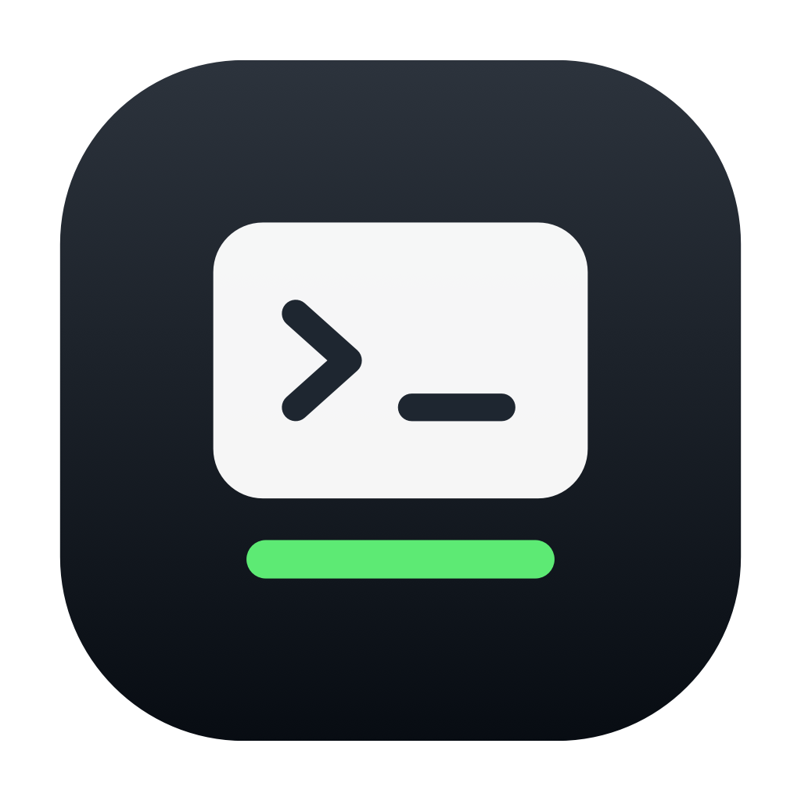
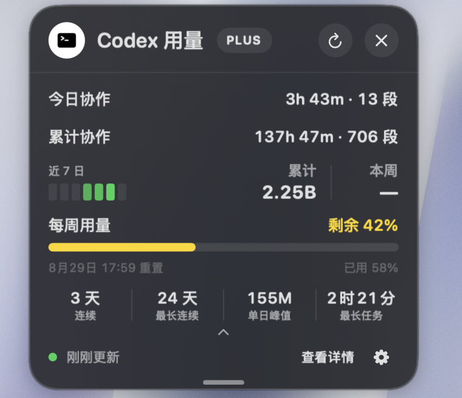
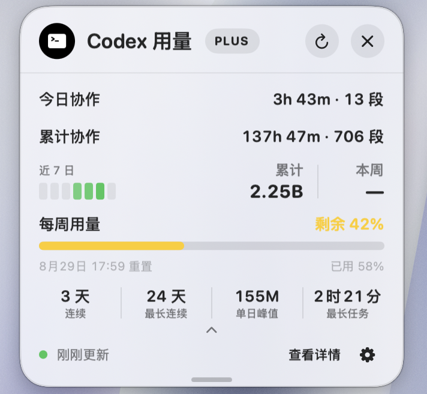
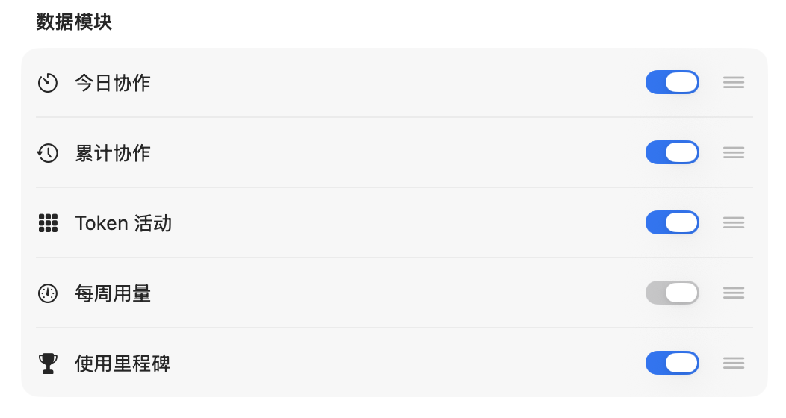
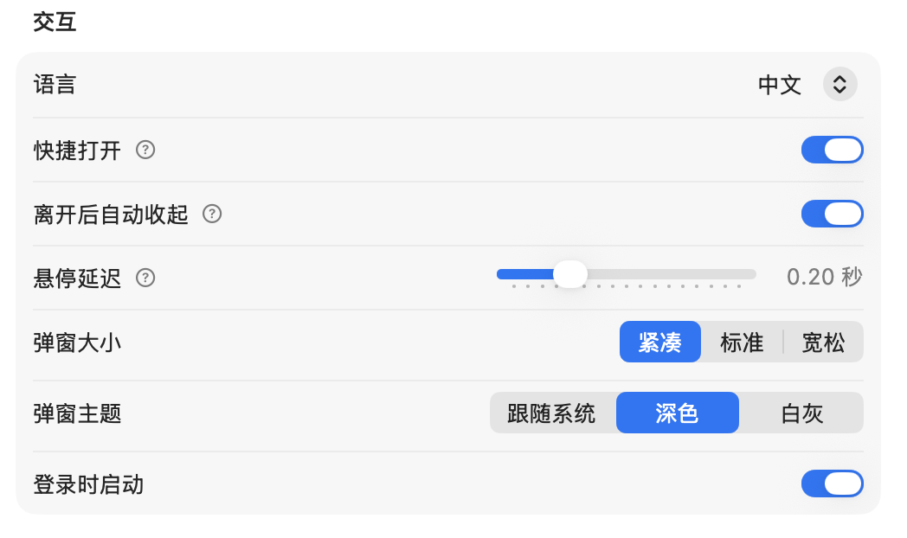
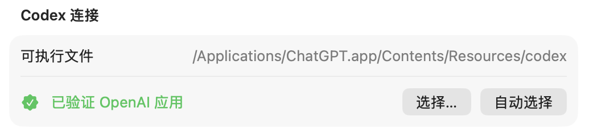

# QuotaNotch

  

  <strong>把 Codex 用量放在 MacBook 刘海旁。</strong> 
  一款原生 macOS 助手，用于查看每周额度与可选活动摘要。

  <a href="README.md">English</a> · <strong>简体中文</strong> · <a href="README.zh-Hant.md">繁體中文</a>

  <a href="https://github.com/GuojianSun/QuotaNotch/releases/latest"><strong>下载最新版本</strong></a>
  ·
  <a href="#下载与安装">安装说明</a>

QuotaNotch 可从 MacBook 的物理刘海位置展开，让当前 Codex 每周额度始终靠近你的工作流。没有刘海或使用外接显示器时，也可以通过菜单栏打开。

## 界面

### 展开的活动视图

### 白灰主题

### 可配置的数据模块

<strong>更多设置</strong>

#### 交互

#### Codex 连接

截图来自真实的 SwiftUI/AppKit 界面，展示的是某一时点的聚合数据；实际数值取决于每位用户的账户和本机历史。

## 核心功能

- 指针悬停在刘海处即可打开，也可随时使用菜单栏入口。
- 查看每周用量、剩余比例、准确重置时间、刷新状态和 Codex 方案名称。
- 按需展开 Token 活动、协作统计和使用里程碑。
- 自定义模块顺序，并选择紧凑、标准或宽松三档面板宽度。
- 支持跟随系统、深色和白灰主题。
- 可将面板拖离刘海；展开和收起时顶部标题栏保持稳定。
- 可调整登录时启动、悬停延迟和指针离开后的行为。
- 支持 English、简体中文和繁體中文。

## 数据模块

| 模块 | 内容 |
| --- | --- |
| **每周用量** | 已用与剩余比例、重置时间、方案名称及符合条件时的重置卡提示；始终显示。 |
| **Token 活动** | 上游提供时显示近 7 日热力图、累计 Token 和本周 Token。 |
| **今日协作** | 可选的本机今日任务时长与有效段数摘要。 |
| **累计协作** | 从兼容的本机 Codex 历史中恢复协作时长和段数。 |
| **使用里程碑** | 上游提供时显示当前连续、最长连续、单日峰值和最长任务。 |

额度和 Token 聚合数据由本机 Codex 进程使用用户现有登录读取。可选协作统计只在这台 Mac 上提取任务计时和终态元数据；QuotaNotch 不提取或保存对话正文。

## 系统要求

- macOS 14 Sonoma 或更高版本
- Apple 芯片 Mac（M1 或更新）
- 已登录 Codex
- OpenAI 签署的 Codex／ChatGPT macOS 应用内附 Codex，或由用户明确选择的其他 Codex 可执行文件

物理刘海不是必需条件；菜单栏入口可用于受支持的 Mac 和外接显示器。

## 下载与安装

1. 从 [GitHub Releases](https://github.com/GuojianSun/QuotaNotch/releases/latest) 下载最新 DMG。
2. 打开 DMG，将 **QuotaNotch** 拖入“应用程序”。
3. 从“应用程序”打开 QuotaNotch。

如果 macOS 在首次启动时阻止打开，请进入**系统设置 → 隐私与安全性**，仅对 QuotaNotch 选择**仍要打开**。

每个 Release 同时提供 SHA-256 校验值；发布完整性说明和漏洞报告入口见[安全政策](SECURITY.md)。

## 隐私

QuotaNotch 不包含分析、广告或用户跟踪 SDK，也不会上传对话内容。可选协作统计在本机处理，并可随时从设置中清除。额度查询仍由用户现有的 Codex 会话与服务通信。

完整说明见[隐私政策](PRIVACY.md)。

## 更新

应用内更新使用 HTTPS feed 和 Sparkle EdDSA 签名。正式版与测试版分开选择；只有更新包签名与 QuotaNotch 内置公钥匹配时才会被接受。

## 支持

- 功能建议与问题反馈：[GitHub Issues](https://github.com/GuojianSun/QuotaNotch/issues)
- 安全问题：[私密漏洞报告](https://github.com/GuojianSun/QuotaNotch/security/advisories/new)
- 版本历史：[更新日志](CHANGELOG.md)

请勿在 Issue 中公开 `auth.json`、访问令牌、对话内容或私人路径。

## 许可与归属

本仓库是 QuotaNotch 的公开产品页、文档、支持和二进制分发仓库，实作源码保持私有。官方安装包适用专有的 [QuotaNotch 二进制许可](BINARY-LICENSE.md)，第三方组件保留各自许可。

Copyright © 2026 Guojian Sun. All rights reserved.

QuotaNotch 是独立项目，与 OpenAI 不存在隶属或背书关系。OpenAI、Codex 与 ChatGPT 是 OpenAI 的商标。
