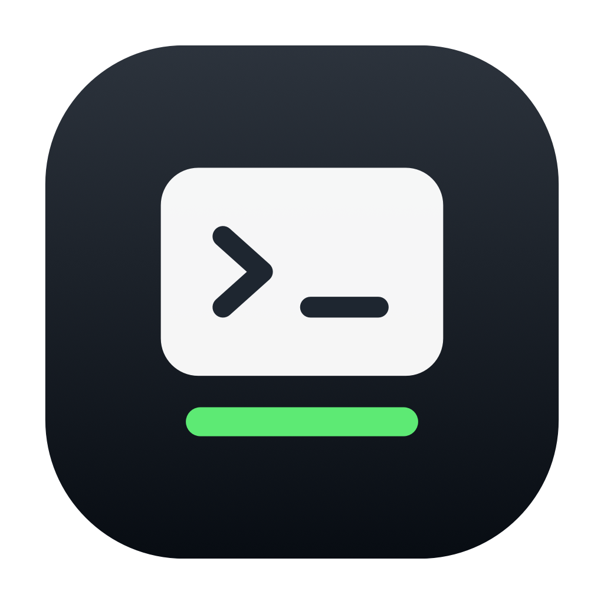
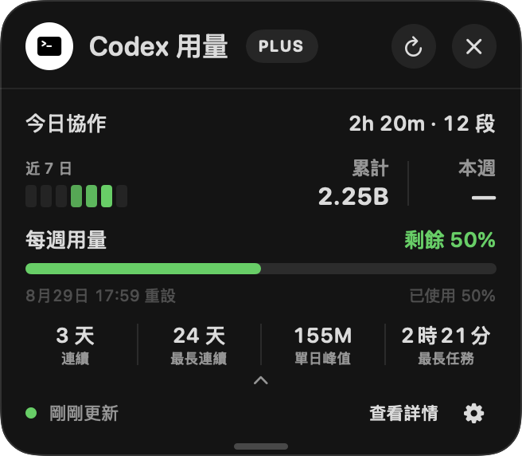
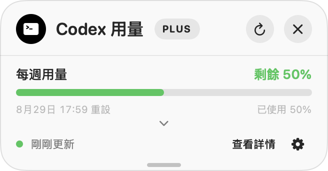
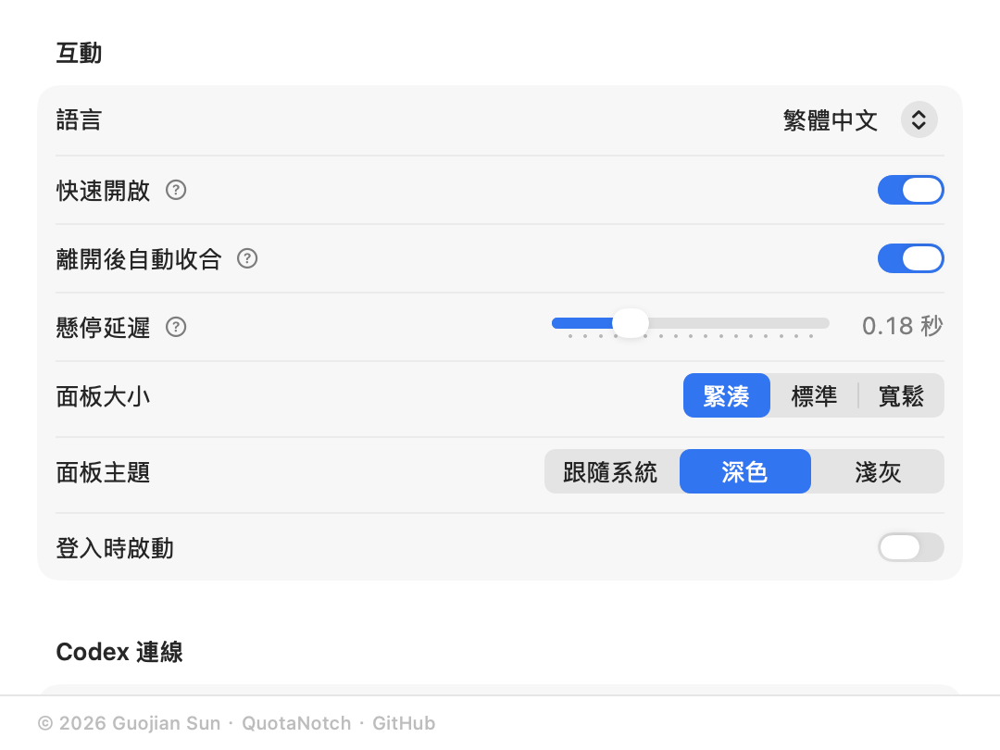

# QuotaNotch

  

  <strong>把 Codex 用量放在 MacBook 瀏海旁。</strong> 
  一款原生 macOS 輔助工具，用來查看每週額度與可選活動摘要。

  <a href="README.md">English</a> · <a href="README.zh-CN.md">简体中文</a> · <strong>繁體中文</strong>

  <a href="https://github.com/GuojianSun/QuotaNotch/releases/latest"><strong>下載最新版本</strong></a>
  ·
  <a href="#下載與安裝">安裝說明</a>

QuotaNotch 可從 MacBook 的實體瀏海位置展開，讓目前的 Codex 每週額度始終靠近你的工作流程。沒有瀏海或使用外接顯示器時，也能透過選單列開啟。

## 介面

### 展開的活動面板

### 精簡面板

### 互動設定

截圖來自真實的 SwiftUI/AppKit 介面，顯示某一時點的彙總資料；實際數值取決於每位使用者的帳戶與本機歷史。

## 核心功能

- 指標停留在瀏海處即可開啟，也能隨時使用選單列入口。
- 查看每週用量、剩餘比例、確切重設時間、重新整理狀態與 Codex 方案名稱。
- 視需要展開 Token 活動、協作統計與用量里程碑。
- 自訂模組順序，並選擇精簡、標準或寬鬆三種面板寬度。
- 支援跟隨系統、深色與淺灰主題。
- 可將面板拖離瀏海；展開和收合時頂部標題列保持穩定。
- 可調整登入時啟動、停留延遲與指標離開後的行為。
- 支援 English、简体中文與繁體中文。

## 資料模組

| 模組 | 內容 |
| --- | --- |
| **每週用量** | 已用與剩餘比例、重設時間、方案名稱，以及符合條件時的重設卡提示；始終顯示。 |
| **Token 活動** | 上游提供時顯示近 7 日熱度、累計 Token 與本週 Token。 |
| **今日協作** | 可選的本機今日任務時間與有效段數摘要。 |
| **累計協作** | 從相容的本機 Codex 歷史中還原協作時間與段數。 |
| **用量里程碑** | 上游提供時顯示目前連續、最長連續、單日峰值與最長任務。 |

額度與 Token 彙總資料由本機 Codex 程序使用使用者現有登入讀取。可選協作統計只在這台 Mac 上擷取任務計時與終態中繼資料；QuotaNotch 不會擷取或保存對話正文。

## 系統需求

- macOS 14 Sonoma 或以上版本
- Apple 晶片 Mac（M1 或更新）
- 已登入 Codex
- OpenAI 簽署的 Codex／ChatGPT macOS 應用程式內附 Codex，或由使用者明確選取的其他 Codex 執行檔

實體瀏海不是必要條件；選單列入口可用於受支援的 Mac 與外接顯示器。

## 下載與安裝

1. 從 [GitHub Releases](https://github.com/GuojianSun/QuotaNotch/releases/latest) 下載最新 DMG。
2. 開啟 DMG，將 **QuotaNotch** 拖入「應用程式」。
3. 從「應用程式」開啟 QuotaNotch。

如果 macOS 在首次啟動時阻止開啟，請前往「**系統設定 → 隱私權與安全性**」，僅對 QuotaNotch 選擇「**強制打開**」。

每個 Release 會同時提供 SHA-256 校驗值；發佈完整性說明與漏洞回報入口請見[安全政策](SECURITY.md)。

## 隱私權

QuotaNotch 不包含分析、廣告或使用者追蹤 SDK，也不會上傳對話內容。可選協作統計在本機處理，並可隨時從設定中清除。額度查詢仍由使用者現有的 Codex 工作階段與服務通訊。

完整說明請見[隱私權政策](PRIVACY.md)。

## 更新

應用程式內更新使用 HTTPS feed 與 Sparkle EdDSA 簽章。正式版與測試版分開選擇；只有更新封包簽章與 QuotaNotch 內建公鑰相符時才會被接受。

## 支援

- 功能建議與問題回報：[GitHub Issues](https://github.com/GuojianSun/QuotaNotch/issues)
- 安全問題：[私密漏洞回報](https://github.com/GuojianSun/QuotaNotch/security/advisories/new)
- 版本歷史：[更新日誌](CHANGELOG.md)

請勿在 Issue 中公開 `auth.json`、存取權杖、對話內容或私人路徑。

## 授權與歸屬

本儲存庫是 QuotaNotch 的公開產品頁、文件、支援與二進位發行儲存庫，實作原始碼維持私有。官方安裝檔適用專有的 [QuotaNotch 二進位授權](BINARY-LICENSE.md)，第三方元件保留各自授權。

Copyright © 2026 Guojian Sun. All rights reserved.

QuotaNotch 是獨立專案，與 OpenAI 不存在隸屬或背書關係。OpenAI、Codex 與 ChatGPT 是 OpenAI 的商標。
